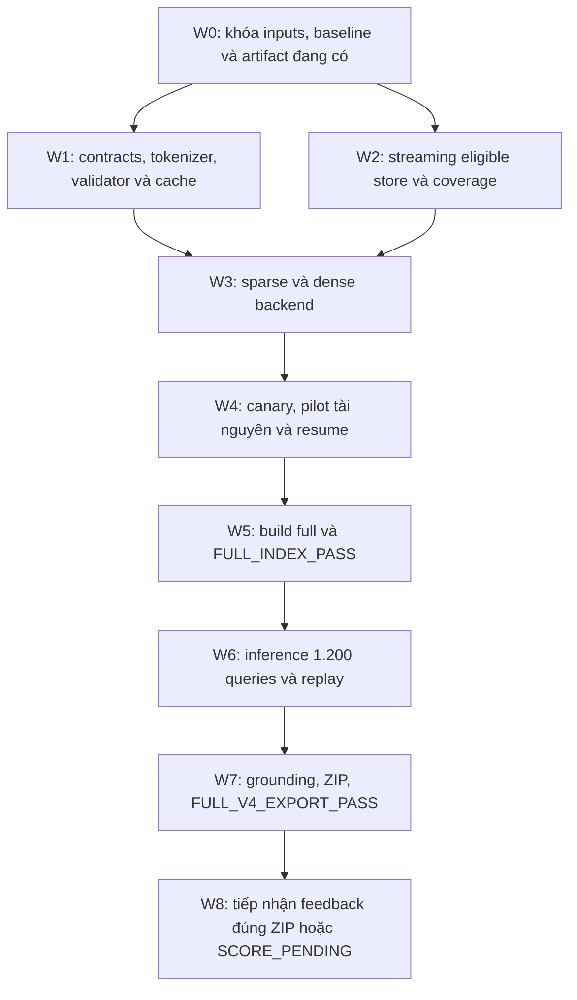

# Kế hoạch Task 4 V4: backend toàn corpus và output đủ điều kiện nghiệm thu

> **Cập nhật 21/10/2026:** theo chỉ đạo thực hiện mới sau lượt review, dense/full index đã đạt `FULL_INDEX_PASS`; xem [báo cáo thực thi](v4_task4_full_index_execution_result_20261021_vi.md). Điểm dừng hiện hành là trước inference đủ 1.200 queries và export; F2 vẫn chưa đo.

Ngày lập: 16/10/2026. Trạng thái: **PLAN — các mục chưa hoàn tất dưới đây chưa được triển khai hoặc chạy bởi tài liệu này**.

Mục tiêu: tạo baseline V4 có thể chạy lại trên 1.200 official queries, dùng toàn bộ eligible Phase 1/2 release; xuất `submission.zip` có schema, coverage, grounding và hashes đã kiểm chứng. F2 chính thức chỉ ghi sau khi có scorer/gold hoặc feedback tương ứng artifact.

Đây là kế hoạch thực hiện tiếp sau [báo cáo sửa evidence](v4_evidence_fixes_execution_20261016_vi.md). Tài liệu này cụ thể hóa F2–F5 của [kế hoạch trước Task 4](v4_evidence_fixes_before_task4_plan_20261016_vi.md), thay thế phần thiết kế Task 4 cũ lấy 2/6 passages đầu trong [kế hoạch lịch sử](full_index_baseline_submission_task3_task4_plan_20261016_vi.md). Khi có khác biệt, dùng contracts và gates tại đây cho lần triển khai tiếp theo.

## 1. Chuẩn đầu ra và giới hạn kết luận

| Mức | Được phép kết luận khi | Đầu ra bắt buộc |
|---|---|---|
| `CONTRACT_PASS` | Selection/export, tokenization, scoring/cache và lỗi inference được kiểm tra | Contract/config đã khóa; test report; truncation audit; cache/replay report |
| `FULL_INDEX_PASS` | Toàn bộ eligible source/passage có store và sparse/dense index đúng identity; canary, resume và benchmark đạt | Index manifest complete; coverage, mapping, integrity, parity và resource reports |
| `FULL_INFERENCE_PASS` | 1.200/1.200 queries complete, không có failed/pending, trace/score caches đủ để replay | Query status, candidates, scores, selected results, diagnostics và runtime report |
| `FULL_V4_EXPORT_PASS` | JSON/ZIP đúng contract, grounding toàn output đạt, replay khớp và artifact hashes nối được | ZIP + validation report + run manifest + báo cáo bàn giao |
| `FULL_V4_SCORED` | Có score/feedback hợp lệ nối đúng ZIP/hash/query set/phase | Scoring receipt, raw feedback và metrics chính thức |

`FULL_V4_EXPORT_PASS / SCORE_PENDING` là kết thúc kỹ thuật hợp lệ. Nó không chứng minh F2 tăng. Không dùng output nhiều hơn, subset parity hay recall proxy để suy điểm mới. Lượt nộp BTC là bước riêng; kế hoạch này chuẩn bị artifact và đường tiếp nhận score, không tự thực hiện upload.

## 2. Điểm xuất phát đã có bằng chứng

| Thành phần | Hiện trạng | Việc còn thiếu |
|---|---|---|
| Task 3 snapshot | 1.000 docs, 2.743 passages, 20 official queries; IDs/offsets/provenance giữ nguyên | Dùng làm reference canary, không gọi là full corpus |
| V4 retrieval | Full-body document BM25, BM25 mọi passage, dense mọi passage trong snapshot | Builder và disk dense search toàn release |
| Selection/export | Selector explicit; adapter không cắt `[:1]`; không xuất unscored khi reranker bật | Strict validator và durable score cache toàn run |
| Rerank arms | A0/A1/A2 đã chạy; A2 xuất 224 evidence trên 20 queries, A0/A1 xuất 200 | Chưa có bằng chứng relevance/F2 để đổi baseline |
| Truncation | A2 có 181/4.000 rerank pairs dài hơn 512 tokens | Audit dense/query và mô phỏng đúng input thực sau truncation |
| Disk canary | SQLite source/passage store và BM25; parity 20/20 khi chia sẻ cùng dense/reranker RAM | Chưa có dense trên đĩa, full streaming builder và resume production |
| Tests | Báo cáo hiện có ghi 21/21 checks liên quan PASS | Bổ sung các test âm và toàn corpus theo từng gate |

Reference: `outputs/v4/phase2_subset/20261016/selection_seed20261016/`. A0 sau selection fix: `outputs/v4/reference_20q_20261016_selection_fix/`. Disk canary: `outputs/v4/disk_subset_canary_20261016/`.

Baseline pre-fix có hạn chế metadata: config hash được chụp sau khi config thay đổi song song. Không dùng manifest đó để chứng minh đầy đủ fingerprint pre-fix. Các canary mới phải khóa hashes trước khi nạp models/inference và xác nhận lại khi kết thúc.

## 3. Khóa phạm vi dữ liệu và cấu hình baseline

### 3.1. Dữ liệu

| Input | Đường dẫn / giá trị |
|---|---|
| Phase 1 release | `outputs/vibiomir_phase1_full_20261014_v1/release/phase1_release_manifest.json` |
| Phase 2 release | `outputs/vibiomir_phase2_full_v2/manifests/phase2_release_manifest.json` |
| PASS allowlist | Các parts được Phase 1 release tham chiếu dưới `release/pass_document_ids/` |
| Exclusions | `configs/vibiomir/phase2_semantic_staging_20261015.json`: 6 doc IDs |
| Official corpus | `outputs/vibiomir_official_verify_20261012/links_corpus_vi_en_zh.parquet`: 1.220.598 rows |
| Official queries | `outputs/vibiomir_official_verify_20261012/query.parquet`: 1.200 rows; lấy set IDs từ file, không giả định IDs liên tiếp |
| Expected eligible | 1.073.525 docs / 2.951.224 passages, phải xác nhận bằng joins trên releases |

Phase 2 manifest hiện ghi 922 parts, 1.073.531 docs và 2.951.273 passages trước semantic exclusions. Sáu exclusions phải được đối chiếu thực tế với 49 passages bị loại. Nếu số thực khác dự kiến: dừng publish, xuất discrepancy report; không sửa expected count để ép PASS.

Eligible corpus là tập nội dung đủ điều kiện, khác official URL inventory. Phải xuất anti-join theo IDs và phân loại lý do; không lấy phép trừ row counts làm bằng chứng coverage theo identity. Không crawl/rechunk hoặc sửa release để hoàn thành baseline này. Phase 3 dedup không tham gia baseline; hai official IDs trùng text vẫn giữ riêng.

### 3.2. A0 baseline được khóa

| Thuộc tính | Giá trị/semantics |
|---|---|
| Document sparse | Title + toàn bộ normalized source; V4 tokenizer và BM25 hiện tại, k1=1,2; b=0,75; top-400 |
| Passage sparse | Mọi eligible passage; V4 tokenizer; global DF/average length; top-200 |
| Passage dense | Mọi eligible passage; input title + `\n` + passage khi có title; cosine; top-200 |
| Embedding model | BGE-M3 revision `5617a9f61b028005a4858fdac845db406aefb181`; passage/query max length 512 cho baseline |
| Fusion | RRF k=60 trên keys `(official_id, passage_id)`; document hit có passage ID null; cap 400 mixed items |
| Parent aggregation | Giữ V4 hiện tại: max fused document item + max fused passage item; không đổi thành parent-level RRF |
| Evidence fallback | Parent-filtered passage BM25; không có passage phù hợp thì trace reason, không tự lấy passage đầu |
| Reranker | BGE-reranker-v2-m3 revision `953dc6f6f85a1b2dbfca4c34a2796e7dde08d41e`; raw logits; max length 512; precision phải ghi rõ |
| Pair allocation | `document_order`; tối đa 3 evidence/doc; tổng tối đa 200 pairs/query |
| Selection | `max_docs=200`, `max_chunks=60`, `chunks_per_doc=1`; chỉ chọn evidence đã score; không có threshold mặc định |
| Batch result limit | **Truyền explicit `result_limit=200`**, không kế thừa mặc định `retrieve(..., limit=10)` |
| Optional stages | ICD, intent, expansion, ANN, Phase 3 canonicalization và threshold legacy tắt |

Với A0 và mỗi selected doc cần ít nhất một evidence, `max_chunks=60` làm số docs xuất hiệu dụng không vượt 60/query, dù max_docs và result_limit đều là 200. Đây là policy baseline nội bộ, không phải tuyên bố BTC bắt buộc các cap này. API mặc định limit 10 có thể giữ cho phục vụ; parity API/CLI/batch chỉ so khi cùng limit/config.

Không tự nhập threshold -2/-2,5 từ `r2ai`. A1 parent-first, A2 cap2 và max length lớn hơn chỉ chạy ở arm riêng sau khi giữ được reference. Mọi thay đổi title formatting, tokenizer, pooling, normalization, precision hoặc max length phải đổi fingerprint của stage tương ứng.

## 4. Trình tự thực hiện và gates



W1 và W2 có thể làm độc lập sau W0. Chỉ tiêu thụ artifact đã complete và đúng fingerprint. W5 không cần chờ tuning relevance A1/A2; W6 phải chờ `FULL_INDEX_PASS` và `CONTRACT_PASS`.

### W0 — Khóa lần chạy và phân loại artifacts có thể tái sử dụng

Công việc:

1. Kiểm tra tiến trình đang chạy, command/stage/output/checkpoint, GPU/RAM/disk thực tế; không kết luận dựa vào tên V4. Không sửa config/code worker đang tiêu thụ giữa một run.
2. Khóa release links và hashes của manifests, frozen chunking config, semantic exclusions, official corpus/queries, models/tokenizers và snapshot canary.
3. Chụp config đã resolve, code hashes, dependency versions, Git HEAD và diff/inventory của code untracked. Không dùng mỗi Git HEAD trong worktree hiện đang dirty.
4. Lập bảng artifact: reuse được, cần bổ sung, cần rebuild, không dùng. Chỉ reuse embeddings khi input payload, row mapping, model và representation fingerprint khớp.
5. Tạo run namespace mới, không ghi đè output trước. Chụp hash trước stage và đối chiếu khi hoàn tất; input thay đổi thì stage FAIL.

Output: `locks/corpus_lock.json`, `locks/baseline_config.json`, `locks/implementation_lock.json`, `locks/environment.json`, `locks/artifact_reuse_report.json`, `locks/job_inventory.json`.

Gate `G0_LOCK_PASS`: mọi dependency có hash/identity; baseline A0 và result_limit explicit; mỗi job/artifact được phân loại có căn cứ. Thiếu artifact hợp lệ thì build mới trong namespace mới, không ép reuse.

### W1 — Hoàn thiện contracts, tokenization, score cache và validator

Công việc:

1. Chuẩn hóa backend interfaces cho source lookup, passage lookup, document sparse, passage sparse và passage dense. `build_pipeline` là nơi nối stages; CLI/API/batch dùng cùng orchestration. Đưa disk canary về đường factory được kiểm, tránh duy trì hai bộ ranking logic.
2. Kiểm tra config/index/model agreement: models bật phải có stage thực, đúng revision/representation; unsupported field hoặc sai budget phải fail. Index complete thiếu một file/partition không được load.
3. Thêm dense boundary checks: đúng dimension thực đo, đúng số vectors/rows, finite values, norm và mapping identity. Không hardcode dimension chỉ theo tên model.
4. Audit tokenization bằng đúng tokenizer của hai adapters: dense query; title+passage; reranker pair query + title+passage. Lưu token counts trước/sau, query/title/passage bị mất tokens ở đâu; raw pair length đơn thuần chưa đủ chứng minh phần evidence nào model thấy.
5. Baseline 512 được giữ như reference với truncation công bố. Fixture có từ khóa cuối model input phải thể hiện được tình huống bị cắt; không gộp nó với test passage cuối tài liệu. Arm long-input cần đo giới hạn model/runtime và relevance riêng; chỉ reranker input đổi thì không rebuild dense, dense input đổi thì build dense arm mới.
6. Durable score cache keyed bằng exact query text/hash + official query ID ở ledger + corpus/release + parent/passage ID + source/title/passage/input hashes + model/tokenizer revisions + input formatting + max length/truncation + precision/runtime scoring contract. Lưu raw score và trạng thái từng pair. Query status tách `pending/running/complete/failed`; thiếu score/exception không trở thành prediction rỗng.
7. Selection replay được thay policy và limit trong phạm vi pairs đã chấm; yêu cầu pair allocation mới, model/input mới thì cache thiếu được chấm bổ sung, không giả định trace cũ đã đủ.
8. Thêm validator native V4 theo contract tại mục 6. Có thể tham khảo schema và package format local cũ, nhưng V4 runtime/validator không import pipeline `r2ai`.
9. Khóa deterministic order: sparse `(score desc, parent ID, passage ID)`; dense tie theo mapping identity thay vì row position. Dense hiện dùng reverse row order khi cosine bằng nhau: nếu sửa để stable identity, ghi thay đổi contract riêng và regenerate canary trước so backend. Reranked doc/evidence giữ stable ID tie-break của V4.

Output: `contracts/output_contract.json`, `contracts/cache_contract.json`, `contracts/order_contract.json`, `reports/truncation_audit.parquet`, `reports/contract_tests.json`, `reports/cache_replay.json`, config production explicit.

Gate `G1_CONTRACT_PASS`:

- Tail passage qua lexical và dense độc lập; fused/rerank/selection/CLI/API/export giữ identity/text với budget fixture đủ.
- Cap2 xuất đủ hai selected evidence; cùng text khác parent còn nguyên; cùng parent/text trùng xử lý đúng mục 6.
- Wrong count/dimension, NaN/Inf, query lỗi, sai cache fingerprint và missing model/index đều FAIL đúng stage.
- Đổi selection replay thành công; đổi payload/model/tokenization không dùng cache cũ. Cache bị truncate/corrupt bị từ chối.
- 100% selected/exported equality theo contract; API/CLI/batch so cùng config/limit.

### W2 — Streaming eligible corpus store và coverage reconciliation

Công việc:

1. Đọc đúng shard list trong manifests; verify checksum trước khi tiêu thụ. Stream Phase 1 clean text, PASS allowlist và Phase 2 passages theo batch, không materialize hàng triệu Python objects.
2. Join official doc IDs/URLs, Phase 1 PASS và semantic exclusions. Mỗi source kiểm normalized-text hash; mỗi passage kiểm ID generation/provenance, parent URL/hash, language, `0 <= start < end <= len(source)` và `source[start:end] == passage_text`.
3. Lưu source/passage lookup trên disk. Mỗi index row map về release + parent/passage identity + input/text hash; FK/unique constraints có kiểm tra thực tế. Query path lookup theo keys/index, không quét tất cả shards.
4. Xuất ledger eligible/excluded/missing/held/unknown/duplicate và anti-joins với official inventory. Chỉ ghi lý do khi có bằng chứng từ input, phần chưa giải thích ghi riêng.
5. Store complete chỉ publish khi source count, passage count, distinct parents và anti-joins nhất quán; build lỗi để checkpoint/incomplete riêng.

Output: `store/`, `mappings/`, `coverage/coverage_ledger.parquet`, `coverage/official_not_eligible.parquet`, `coverage/coverage_report.json`, `reports/input_integrity.json`.

Gate `G2_STORE_PASS`: zero unknown/excluded IDs trong eligible store; zero duplicate identities/orphans/hash/offset/URL violations; expected eligible counts reconcile; mọi eligible doc có passages và mọi passage có source. Kiểm integrity trên toàn input đã tiêu thụ, không chỉ sample.

### W3 — Sparse và dense backend đúng V4 semantics

Công việc sparse:

- Build document BM25 từ title + full body và passage BM25 từ mọi eligible passage. Giữ tokenizer/công thức V4, lưu global N/DF/total length/average length.
- Nếu chia partitions, global stats được tính trước final query scoring; merge exact global top-K. Không dùng IDF riêng mỗi shard.
- Benchmark SQLite canary trước khi chọn implementation full: đo posting scans, số SQL calls, fallback parent lookup và query memory. Loại N+1 identity queries bằng lookup theo batch/join nếu cần. Nếu đổi storage engine, giữ score formula và kiểm parity lại.

Công việc dense:

- Encode mọi eligible passage một lần, chia partitions có row mapping cố định. Lưu FP32 vectors hoặc dtype khác đã khóa và đo; norm/dimension/finite checks theo partition.
- Baseline exact cosine search theo block/memmap; merge top-200 toàn corpus và stable identity tie-break, không gate passage theo document-first pool chỉ đọc đầu bài.
- Số vector rows phải bằng số eligible passages; title chỉ nằm trong model input. Không lưu title prefix vào evidence xuất.
- ANN/quantization chưa thuộc baseline. Chỉ thêm như arm sau nếu benchmark cho thấy cần và có phép đo candidate recall so exact.

Output: `indexes/document_bm25/`, `indexes/passage_bm25/`, `indexes/passage_dense/`, `mappings/dense_rows/`, `index_manifest.building.json`.

Gate `G3_BACKEND_CANARY_PASS`: canary disk dense hoạt động thật và factory nối đủ stages; ID/row/hash validation PASS; không dùng dense RAM của reference để gọi là disk-dense parity; tokenization và order contract giống reference đã khóa.

### W4 — Canary correctness, pilot tài nguyên và resume

Protocol khóa trước khi chạy:

| Kiểm tra | Scope | Tiêu chí |
|---|---|---|
| Exact sparse parity | Locked 1.000 docs / 20 queries | Cùng candidate IDs/order và selected payload; raw BM25 scores `atol=1e-10, rtol=1e-10` |
| Exact dense parity | Cùng vectors/cosine contract trên snapshot | Cosine `atol=1e-5, rtol=1e-5`; top-K/order khớp ngoài vùng ties; ties phải theo cùng order contract |
| End-to-end parity | 20 queries; cùng cached vectors/pair scores khi cô lập backend | Candidate/selected IDs/order/text và canonical payload SHA bằng nhau |
| Independent model rerun | Cùng locked snapshot/config | Rerank scores `atol=1e-3, rtol=1e-3` cho precision đã khóa; score-close mà đổi output vẫn phải phân tích, không tự PASS |
| Resource pilot | 10.000 eligible docs; mọi passage của chúng; 50 official queries, IDs khóa trước | Đủ resource report và ETA có căn cứ; không suy relevance từ sample này |
| Resume | Dừng sau partition complete và giữa partition; retry lỗi/OOM mô phỏng | Không duplicate/missing; partition complete không encode lại; logical fingerprints/output bằng run liên tục |
| Negative integrity | Thiếu shard, sai SHA/mapping, exclude, URL/offset, config/model mismatch | Exit lỗi, không publish complete, không tạo prediction rỗng thay lỗi |

Tolerances là tiêu chí đề xuất khóa trước canary, không phải số đo đã đạt. Nếu precision/backend không đáp ứng, chẩn đoán và đổi contract/arm rồi chạy lại; không nới ngưỡng sau khi nhìn lỗi để ép PASS. Với ties gần ngưỡng top-K, lưu scores/IDs liên quan và khóa cách xử lý dùng chung trước regenerate reference.

Resource budget khởi đầu: 1 GPU đang rảnh, CPU threads tối đa 8, RSS task tối đa 32 GiB, task disk tối đa 128 GiB, chừa tối thiểu 20% VRAM khả dụng lúc khóa pilot. Đây là budget đề xuất, cần kiểm resource thật trong W0. GPU ID không hardcode theo lần trước. Khi vượt budget: checkpoint, giảm batch/block size và đo lại; không đổi dtype/algorithm âm thầm. Resource shortage là trạng thái operational, không tự kết luận correctness FAIL.

Đo riêng hashing/load, sparse build/query, dense encode/search, rerank, export; ghi wall time, docs/passages/tokens mỗi giây, RSS peak, VRAM allocated/reserved, disk temporary/final, latency mean/P50/P95 cold/warm. ETA full = khối lượng từng stage / throughput đo + I/O/hash/checkpoint overhead; công bố assumptions và khoảng dao động. Với dimension thực đo d và FP32, raw dense storage là `2.951.224 × d × 4` bytes, chưa gồm mappings, indexes, cache và temporary files.

Output: `reports/canary_parity.json`, `reports/pilot_ids.json`, `reports/resource_benchmark.json`, `reports/resume_test.json`, `reports/full_run_estimate.json`.

Gate `G4_PILOT_PASS`: correctness/resume đạt, không còn mismatch chưa giải thích, resource budget và ETA được ghi trước full build. Pilot dev/qrels có thể chạy bổ sung để phát hiện regression; thiếu gold giữ quality `UNMEASURED`, không thay bằng integration PASS.

### W5 — Build full corpus và publish index

1. Chạy build theo partition với W0 lock. State transitions `pending → building → verified → complete`; per-partition temp → atomic publish sau row/hash checks. Ledger commit phải recover được nếu crash giữa file publish và metadata commit.
2. Resume cùng fingerprints mới được skip complete partitions; verify metadata và files trước reuse. Incomplete partition rebuild hoặc resume từ boundary được chứng minh; không nối append mù vào nhiều SQLite files rồi gọi transaction chung.
3. Sparse global stats, store mappings và dense vectors cuối cùng phải cùng corpus lock; checksum toàn partitions và kiểm đủ sets eligible IDs/passage IDs/rows.
4. Query preflight xác nhận models bật, index counts/representations/revisions đúng và đủ required artifacts. API readiness không chỉ kiểm `len(sources)`; phải xác nhận stage readiness tương ứng config.
5. Publish `index_manifest.json` complete sau tất cả checks; manifest tham chiếu mọi partition/checksum và reports. Read-only query runtime không được tạo DB rỗng khi thiếu file.

Output: full store/sparse/dense indexes + `index_manifest.json`, `reports/full_integrity.json`, `reports/full_coverage.json`, `reports/full_build_runtime.json`.

Gate `G5_FULL_INDEX_PASS`: G0–G4 PASS, zero missing/duplicate/unknown eligible identities, mọi vector map đúng passage/source input hash, global sparse stats hợp lệ; full counts reconcile và all consumed input hashes đạt. **Chỉ sau gate này mới mở full-query inference.**

### W6 — Chạy 1.200 queries có cache/checkpoint và replay

1. Load đúng official query snapshot; khóa exact text/hash và ID order. Một smoke đầu trên full index kiểm stages hoạt động/diagnostics/resource, không kỳ vọng output giống subset vì corpus khác.
2. Batch runner truyền explicit `result_limit=200`, dùng A0; lưu branch candidates/scores/ranks, fused mixed items và unique parents, evidence candidates/fallbacks, allocated/scored pairs, selection decisions.
3. Query ledger có attempts, timestamps, error và dependencies. Pair-score cache commit bền vững trước query complete; retry chỉ reuse cache cùng fingerprint, không ghi trùng kết quả. Thay config giữa run tạo run mới.
4. Đo số pairs thực; trần A0 là 240.000 pairs cho 1.200 queries. Không hiểu đây là 240.000 unique passages hay ETA. Ghi zero-score/negative-score riêng với unscored.
5. Sau inference, CPU replay từ scores đã khóa để tạo selected results và export. So canonical output SHA với lần đầu; tiếp tục từ checkpoint phải cho cùng payload.
6. Tổng hợp stage losses và output distribution, theo source language và chiều dài nếu dữ liệu hỗ trợ. Output rỗng do không có eligible candidates là complete có reason; inference failure vẫn failed.

Output: `queries/query_status.parquet`, `candidates/`, `scores/`, `selected/selected_results.jsonl`, `diagnostics/`, `reports/inference_runtime.json`, `reports/replay_report.json`.

Gate `G6_FULL_INFERENCE_PASS`: đúng 1.200 unique expected query IDs; `complete=1200`, `failed=pending=running=0`; every selected evidence có valid finite pair score; trace/cache đầy đủ và replay exact. Không yêu cầu mọi query phải có prediction không rỗng hoặc đủ số cap.

### W7 — Strict validation, ZIP và bàn giao

1. Validate toàn selected results theo mục 6, gồm source-grounding qua eligible store và selected/exported equality. Validate coverage từ official queries/corpus paths explicit, không fallback về corpus cũ.
2. Canonical JSON theo policy tại mục 6; export `predictions.json` và ZIP có duy nhất entry này ở root. Metadata/provenance/scores ở ngoài ZIP.
3. Mở lại ZIP, kiểm CRC, entry names, parse JSON nghiêm ngặt và chạy validator trên chính payload được đọc từ ZIP. So payload với selected bằng equality, không chỉ so counts.
4. Ghi SHA-256 của canonical payload, `predictions.json` bytes và ZIP bytes. ZIP build deterministic: fixed timestamp, entry attributes/order và compression settings; environment ghi trong manifest.
5. Publish package sau validation PASS, có `SHA256SUMS` cho artifacts bàn giao. Manifest không tự hash chính nó; checksum list không tự hash chính nó. Không sửa ZIP sau khi ghi receipt/score linkage.

Output: `export/predictions.json`, `export/submission.zip`, `export/SHA256SUMS`, `reports/validation_report.json`, `run_manifest.json`, `FULL_V4_REPORT.md`.

Gate `G7_FULL_V4_EXPORT_PASS`: G5/G6 đạt; tất cả lỗi validator bằng 0; grounding/selected equality/replay/CRC/coverage PASS; manifest nối config/code/index/cache/ZIP hashes; status score là `SCORE_PENDING` nếu chưa chấm.

### W8 — Tiếp nhận score và đánh giá chất lượng

Khi có đường chấm được yêu cầu thực hiện, xác minh submission instructions/phase/scorer/quota hiện hành từ BTC trước upload. Không lấy comment về quota hoặc size cap trong validator legacy làm luật hiện hành. Không cần chờ bước này để hoàn tất kỹ thuật W7.

Lưu submission ID, thời điểm, phase, ZIP SHA, query IDs, raw feedback và DOCS_F2/CHUNKS_F2/FINAL vào `scoring_receipt.json` và `baseline_metrics.json`. Nếu thiếu scorer/gold/feedback đúng artifact, để metrics chính thức null với status `UNMEASURED`; không ghi 0 thay cho chưa đo. Chỉ so baseline lịch sử khi nối được đúng conditions; nếu khác query set/phase/corpus thì báo giới hạn so sánh.

Gate `G8_FULL_V4_SCORED`: receipt và raw feedback nối đúng artifact; điểm được báo dù thấp hơn lịch sử. Việc tăng F2 là mục tiêu thí nghiệm tiếp theo, không là điều kiện ép baseline đổi cấu hình sau khi đã nhìn kết quả.

## 5. Cấu trúc output bàn giao

```text
outputs/v4/task4/<run_id>/
  locks/                 corpus/config/code/environment/artifact inventory
  contracts/             output/cache/order contracts
  coverage/              ledger, exclusions, anti-joins và reports
  store/                 source/passage lookup đã verify
  mappings/              index row ↔ release/parent/passage/hash
  indexes/               document_bm25/, passage_bm25/, passage_dense/
  checkpoints/           partition states, durable commits, retry metadata
  queries/               query_status.parquet
  candidates/            branch/fused/evidence candidates
  scores/                pair scores và cache metadata
  selected/              selected_results.jsonl
  diagnostics/           per-query stage counts/reasons/truncation/timing
  reports/               gates, integrity, parity, resource, replay, validation
  export/                predictions.json, submission.zip, SHA256SUMS
  index_manifest.json
  run_manifest.json
  FULL_V4_REPORT.md
```

Store/index có thể đặt ở namespace dùng chung ngoài run để tránh copy. Khi đó manifest bắt buộc ghi exact path, immutable artifact fingerprint, counts và checksums. Chỉ đổi selector không cần nhân bản store/vectors hoặc chạy lại models.

Mọi report có tối thiểu: `format_version`, `status`, `scope`, `run_id`, timestamps, input/config/code/artifact hashes, counts, checks, failures/warnings và dependencies. `PASS` phải có evidence path/hash; chưa chạy ghi `NOT_RUN`, không để boolean true mặc định. Stage failed không ngăn giữ checkpoint nhưng không được publish completion của stage hoặc dependent gates.

## 6. Contract JSON/ZIP và validator bắt buộc

### 6.1. Schema dự kiến theo adapter V4 và package local hiện có

```json
[
  {
    "id": 123,
    "relevant_docs": [456],
    "relevant_chunks": [
      {"doc_id": 456, "chunk_text": "Nguyên văn một passage đủ điều kiện."}
    ]
  }
]
```

Đây là minh họa schema; IDs/text trên không phải prediction thật. Expected query IDs lấy từ official snapshot. Record chỉ có ba keys; chunk chỉ có `doc_id` và `chunk_text`. IDs phải là integer JSON, không bool/string/float. Chunk text không rỗng, UTF-8 hợp lệ; không đưa score/title/provenance vào schema submission. Query complete không có prediction dùng hai arrays rỗng.

ZIP convention: duy nhất `predictions.json` ở root, JSON array. Đây là convention đã dùng trong repo; kiểm instructions BTC khi chuẩn bị lượt nộp. Local validator cũ có cap 50 MB dựa trên quan sát, chưa là bằng chứng luật mới. Kế hoạch dùng 50.000.000 bytes làm ngưỡng operational bảo thủ và ghi nguồn; instructions hiện hành nếu khác phải tạo contract/config mới rõ ràng trước package cuối. Không tự cắt evidence text để giảm ZIP; đổi selection tạo arm/export mới và validate lại.

### 6.2. Ma trận checks

| Nhóm | Điều kiện PASS |
|---|---|
| Query coverage | 1.200 records; unique IDs; set IDs bằng chính xác official query set; không missing/extra |
| JSON | Đúng types/keys; strict parse từ chối duplicate object keys/NaN/Inf; không ID bool hoặc coercion âm thầm |
| Document identity | Mọi doc ID thuộc official inventory và eligible store của run; không duplicate parent IDs |
| Parent consistency | Mọi chunk parent nằm trong `relevant_docs`; A0 `with_chunks` mỗi doc có ≥1 exported evidence. Arm `independent` giữ grounded/scored `document_evidence` nội bộ, cho phép doc không có exported chunk; xem plan sửa ngày 21/10 |
| Grounding | Exact passage identity nội bộ → đúng parent/release/URL/source hash/offset; text bằng passage và exact source slice |
| Scoring | Reranker bật: mọi selected evidence có finite score, đúng model/input cache key; không xuất unscored/budget-skipped |
| Caps/limit | Doc count ≤ min(result_limit, max_docs); total chunks ≤ max_chunks; chunks/parent ≤ chunks_per_doc; không ép đạt cap |
| Duplicate output | Không duplicate `(parent_id, chunk_text)`; cùng text ở hai parent khác nhau hợp lệ |
| Selected/exported | Doc membership/order và chunk membership/order/text bằng đúng selected snapshot sau serialization contract |
| Replay | Canonical payload SHA từ CPU replay bằng payload SHA đã khóa |
| ZIP | Duy nhất entry hợp lệ ở root; CRC PASS; không extra file/path; strict JSON payload đạt mọi check trên; size trong operational contract |
| Provenance | Run → index/input/model/config/code/score cache → payload/ZIP hashes nối đầy đủ |

Dedup identity hiện có chưa bảo đảm tránh hai passage IDs khác nhau nhưng text giống nhau trong cùng parent khi cap>1. W1 phải quy định xử lý **trước serializer**: giữ candidate được xếp hạng cao hơn, trace `duplicate_parent_text`; không dedup xuyên parent. Bổ sung fixture này trước nghiệm thu cap2. Với A0 cap1 trường hợp đó không làm duplicate export, nhưng contract vẫn phải kiểm.

Canonicalization: queries theo official ID tăng dần hoặc exact order đã khóa trong contract; docs/chunks giữ thứ tự selected; object keys có thứ tự schema cố định; `ensure_ascii=False`, compact separators, `allow_nan=False`. SHA canonical tính trên UTF-8 payload không trailing newline; SHA file JSON/ZIP tính trên actual bytes. Chọn một query-order policy ở W0 và dùng chung cho run/replay/export.

## 7. Công việc mã nguồn dự kiến

Các đường dẫn mới dưới đây là đề xuất cho triển khai, **chưa phải commands/tools đã tồn tại**. Khi triển khai có thể gộp modules nhưng phải giữ một runtime V4 và cùng contracts.

| Nhóm | Files hiện có cần nối/sửa | Files/chức năng bổ sung dự kiến |
|---|---|---|
| Runtime/config | `core/factory.py`, `core/pipeline.py`, `core/disk_pipeline.py`, `data/prepared.py`, API/CLI | Backend protocols; shared budgets/order; load complete full index; explicit batch limit/readiness |
| Store/coverage | `data/disk_store.py`, `data/phase2_batch.py` | `data/full_release.py`: streaming release validation, joins, coverage và partition iterator |
| Sparse | `retrieval/core.py`, `retrieval/disk_bm25.py` | Global stats artifacts; efficient posting lookup/top-K merge; full builder resume |
| Dense | `retrieval/bge_encoder.py` | `retrieval/disk_dense.py`: partition vectors/mapping, exact block cosine, boundary checks |
| Scores | `ranking/reranker.py`, subset replay | `ranking/score_cache.py`: keyed durable cache, tokenization diagnostics và retry |
| Selection/export | `evidence/selector.py`, `adapters/vibiomir_submission.py` | `adapters/validation.py`: strict native V4 validator; deterministic packager |
| Batch | `scripts/v4/run_locked_subset.py` | `scripts/v4/build_full_index.py`, `run_full_baseline.py`, `validate_export.py`, full replay/preflight |
| Production config | Giữ configs subset/A1/A2 | `configs/v4_phase2_full_a0.yaml`: models enabled, references pin, result_limit và storage/resources explicit |
| Tests | `tests/v4/` | Mapping/hash/coverage negative, full disk-dense canary, tie/restart/cache/grounding/ZIP cases |

## 8. Lịch thực hiện và cách ra quyết định

| Gói | Ước lượng công kỹ thuật | Điều kiện bắt đầu / kết thúc |
|---|---:|---|
| W0 | 0,5 ngày | Input hiện có → G0 |
| W1 | 1–2 ngày | G0 → G1; validator có thể hoàn thiện cùng runner |
| W2 | 0,5–1,5 ngày | G0 → G2 |
| W3–W4 | 1–2 ngày | G1/G2 → G3/G4 |
| W5 | 0,5–1 ngày công vận hành | G4 → G5; compute ETA lấy từ pilot |
| W6–W7 | 0,5–1,5 ngày | G1/G5 → G6/G7 |
| W8 | Theo đường chấm và phản hồi BTC | G7 → SCORE_PENDING hoặc G8 |

Tổng công kỹ thuật dự kiến 4–8,5 ngày, chưa gồm thời gian máy build/inference, chờ GPU/nhãn/scorer/feedback. Đây là dự toán kế hoạch từ phần việc còn thiếu; chưa là cam kết runtime hay số liệu đã chạy.

Nếu có job full build đang chạy, W0 quyết định reuse theo stage/fingerprint: passage store và vectors đúng contract có thể giữ; document index chỉ lấy đầu bài giữ làm legacy artifact; predictions từ serializer cũ phải replay/validate lại từ scores phù hợp. Không dừng hay xóa job/artifact chỉ dựa vào tên.

Thứ tự bắt đầu: **W0 → W1/W2 → W3/W4 → W5 → W6/W7**. Chưa mở full inference khi còn mismatch canary, thiếu dense partition, sai coverage hoặc cache/validator chưa đạt. Nếu chỉ thiếu score BTC sau G7, bàn giao output với `SCORE_PENDING` và liệt kê dependency cụ thể.

## 9. Nội dung báo cáo bàn giao bắt buộc

`FULL_V4_REPORT.md` phải nêu trực tiếp:

1. Trạng thái từng gate và artifact chứng minh; mục chưa chạy ghi rõ.
2. Official inventory, eligible docs/passages, exclusions và anti-join counts cùng hashes.
3. Config A0, budgets thực, result_limit, output count distribution và số query rỗng/lý do.
4. Evidence cuối tài liệu có thể truy hồi ở nhánh nào; truncation còn bao nhiêu và tác động nào chưa đo.
5. Full backend sparse/dense thực dùng, exact/ANN, dtype/dimension, mapping/parity/resume và resource measurements.
6. Coverage 1.200 queries, failed/pending, selected/exported equality, grounding, replay SHA và ZIP CRC/size/hash.
7. Điểm DOCS_F2/CHUNKS_F2/FINAL nếu có receipt đúng artifact; nếu chưa có thì `UNMEASURED`.
8. Commands/config paths thực tế có thể chạy lại, môi trường/revisions và những giới hạn còn tồn tại.

Điều kiện bàn giao kỹ thuật: **G0–G7 đều PASS, đủ artifact review được, score ghi đúng trạng thái**. Một file ZIP sinh được hoặc bộ test unit PASS chưa đủ để kết luận đạt chuẩn output toàn corpus.
