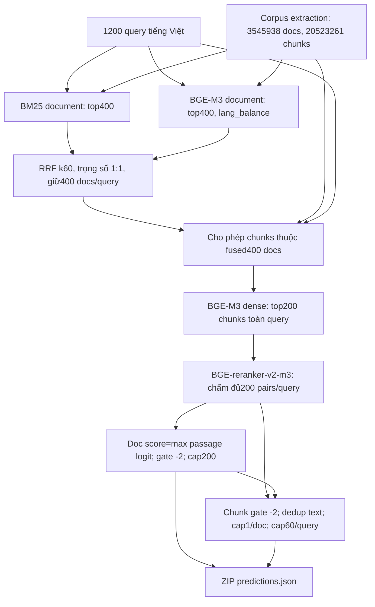

# Retrieval error analysis — Medical-RAG / ViBioMIR

Ngày audit: **08/10/2026, Asia/Ho_Chi_Minh**. Đối tượng duy nhất để giải thích điểm: ZIP `outputs/submissions/vibiomir_threshold_neg2_20261008/submission.zip`, 1.200 query ViBioMIR, selector threshold −2.

## 1. Kết luận và mức độ chắc chắn

**Chưa thể xác định chính xác bottleneck về relevance hoặc phân bổ mức mất FINAL_SCORE cho từng tầng bằng dữ liệu hiện có.** Repo không có gold document/gold evidence áp dụng cho 1.200 query ViBioMIR; 30.000 judgments trong 150 query annotation đều `null`. Official scorer cũng chưa có trong repo và chưa lấy được qua nguồn công khai. Vì vậy không báo Candidate Document Recall@K, số gold bị loại, AUC gold/non-gold, hay F2 theo query bằng số suy đoán. Các ô chưa đo được để trống trong CSV, tương ứng `null`/N/A trong báo cáo.

Tuy nhiên, audit đo được các điểm thắt **về số lượng candidate**, và loại trừ một số cơ chế mất dữ liệu cụ thể:

| Kết quả đã đo | Ý nghĩa được phép kết luận | Điều chưa được phép kết luận |
|---|---|---|
| 400 document/query qua RRF → trung bình 103,23 document/query có passage vào pool200 | Passage retrieval giới hạn độ phủ document mà reranker có thể xét; 356.122/480.000 cặp query–document không có passage trong pool | 74,19% gold bị mất; đây là tỷ lệ candidate, chưa phải recall |
| 123.878 document candidate trước gate → 89.976 document xuất ra | Ngưỡng document −2 loại 33.902 cặp query–document, 27,37% pool parents | 33.902 document đúng bị loại; gold chưa biết |
| `max_docs=200` loại **0 document** | Cap200 không hoạt động trong baseline này, vì pool có tối đa 171 parents/query | Nới cap200 có thể phục hồi document chưa vào pool |
| 240.000 passage đều có score thật, không score null | Ngân sách rerank không bỏ sót passage nào **trong pool200** | Reranker xếp hạng đúng hoặc raw logits đã được hiệu chỉnh |
| Replay selector khớp ZIP và diagnostics ở **1.200/1.200 query** | Không có mất prediction/text từ selector đến ZIP theo artifact hiện có | Official chunk matching chắc chắn chấm đúng các text này |
| 198.515 chunk identity duy nhất trong cache đều khớp text/title của corpus extraction | Không có lỗi join identity/text giữa corpus chunk và ranking cache đã kiểm | Extraction đã giữ đủ gold evidence từ HTML |
| 1.391/240.000 cặp có input dài >512 token, 0,5796% | Có input vượt budget reranker; 413 cặp được xuất ra thuộc nhóm này | Truncation là nguyên nhân chính của CHUNKS_F2 thấp |

Bằng chứng: [audit_summary.json](outputs/retrieval_error_analysis_20261008/audit_summary.json), [stage_gold_loss.csv](outputs/retrieval_error_analysis_20261008/stage_gold_loss.csv), [token_length_summary.json](outputs/retrieval_error_analysis_20261008/token_length_summary.json). Phần 4–8 giải thích cách đo và giới hạn.

**Quyết định kỹ thuật hiện tại:** trước khi đổi model hoặc production config, phải có gold/scorer phù hợp để phân biệt mất relevance ở passage shortlist với các gate/caps. Passage shortlist là điểm hao hụt candidate lớn đã quan sát; chưa đủ bằng chứng để gọi nó là nguyên nhân chính của điểm 0.1681.

## 2. Baseline, provenance và phạm vi thực thi

| Thuộc tính | Giá trị / nguồn |
|---|---|
| FINAL_SCORE | 0.1681 |
| DOCS_F2MACRO / CHUNKS_F2MACRO | 0.2802 / 0.0560 |
| DOCS_PRECISION / DOCS_RECALL | 0.2665 / 0.3190 |
| CHUNKS_PRECISION / CHUNKS_RECALL | 0.0675 / 0.0618 |
| Nguồn điểm | Feedback người dùng đã lưu trong `outputs/evidence/task0_feedback_threshold_neg2_20261008.json`; không tính lại ở lượt audit này |
| SHA-256 ZIP local | `7eeacdd8273502fe5d9ba1dcb76d0689d9c3ba9c737749c4b39bc3c0e89a6e20` |
| SHA-256 ranking cache | `04a9f7bf64fc4bfc702bab756180a5f744bc3cf3fbd08b3d2620e058e31bb84c` |
| Query/corpus fingerprint | Query, chunks và fused candidates hiện tại đều khớp SHA-256 trong header ranking cache |
| Baseline selection | Threshold −2, max_docs200, max_chunks60, 1 chunk/doc, không delta, document-order |

Liên kết feedback với ZIP dựa trên tên run và manifest local. Không có submission ID, SHA của file thực tế đã upload, phase, timestamp scoring hoặc scorer revision từ server; chưa thể xác minh độc lập các trường đó. File `configs/vibiomir/evidence_selector_best_20261008.json` để −2.5 và **không phải selector của ZIP 0.1681**. Báo cáo Task0 cũ dùng diagnostics −2.5 (876 query chạm cap), trong khi audit này dùng đúng −2 (778 query chạm cap). Không trộn hai bộ thống kê.

Bằng chứng: [feedback](outputs/evidence/task0_feedback_threshold_neg2_20261008.json), [baseline config](outputs/submissions/vibiomir_threshold_neg2_20261008/selection_config.json), [baseline summary](outputs/submissions/vibiomir_threshold_neg2_20261008/summary.json), [Task0 manifest](outputs/evidence/task0_baseline_audit_20261008/baseline_manifest.json), [fingerprints mới](outputs/retrieval_error_analysis_20261008/audit_summary.json).

Lượt này chỉ đọc dữ liệu, replay **cùng selector** trong RAM, đo token bằng tokenizer local và viết artifact phân tích. Không chạy model inference, search GPU, calibration, crawler, rebuild index, tạo submission mới hoặc thay cấu hình. Hash source/config và stat index/corpus được chụp trước audit để kiểm tra lại sau; xem `initial_state.json` và `preservation_check.json` trong thư mục artifact.

## 3. Pipeline thực tế của ZIP 0.1681



1. **Extraction.** `r2ai/extract.py:59–78` dùng trafilatura với `favor_recall=True`, giữ bảng, bỏ comments và lxml fallback. `process` tại dòng187–200 pack đoạn văn, cắt theo cap extraction và bỏ chunk có token estimate <16. Theo ghi chép lượt extraction, target220/overlap40; đây là ước lượng CJK + whitespace, không phải tokenizer thực. `pack` tại dòng155–181 không hard-split đoạn dài. Log cuối xác nhận 20.523.261 chunk/3.545.938 document: `outputs/retrieval_extract_20261007.log:72`.
2. **BM25 document.** Title + tối đa 6 chunk đầu/document; Latin words, CJK bigrams; BM25 Lucene k1=1.5, b=0.75. Top400/query, không taxonomy query expansion trong command đã ghi. Nguồn: `r2ai/bm25index.py:48–79, 105–106, 132–144`; `data/vibiomir/bm25idx_crawl_20261007/params.index.json`; `outputs/run_retrieval_crawl_20261007.sh:52–55`.
3. **Dense document.** BGE-M3 biểu diễn title + 2 chunk đầu, max_seq_length256; query max512; vector 1024 chiều, L2-normalized và lưu FP16. Search bật chuẩn hóa score theo nhóm ngôn ngữ trước top400. Stage1 model revision chưa pin trong `index.py`. Nguồn: `r2ai/index.py:36–79, 89–143`; script dòng59–61; `outputs/dense_fuse_crawl_20261007.log:69–76`.
4. **RRF.** Cộng `1/(60+rank+1)` từ dense/BM25, giữ top400. Audit dựng lại từ hai candidate parquet: **0 query sai tập, thứ tự hoặc score** ở tolerance float32 2e-9. Nguồn: `r2ai/fuse.py:45–58`; `audit_summary.json.rrf_reconstruction`.
5. **Passage retrieval.** `rank.py:266–269` chỉ lấy doc ID từ candidate file để tạo allowed set; RRF/BM25 score không được dùng làm feature khi chọn passage. `dense_shortlist:116–132` chấm tất cả chunk trong allowed docs, chọn top200 **toàn query**, không quota mỗi doc. Encoder title-prefix, max512, normalized, model FP16; array embedding lưu float32. Cache có shape chunks=(1.418.063,1024), queries=(1200,1024). Nguồn: `rank.py:47–87, 303–332`; `embedding_cache_headers.json`.
6. **Reranking.** CrossEncoder `BAAI/bge-reranker-v2-m3`, max_length512, FP16, activation identity. Query ghép với title + passage. Pool200/rerank_top200; 240.000 score hữu hạn, 0 null. Tên thư mục có “80” không phản ánh budget thực. Nguồn: `rank.py:181–218`; header cache và `audit_summary.json.ranking_metadata`.
7. **Document selection.** Document được xếp theo passage score cao nhất trong reranked pool (`rank.py:349–360`); gate dùng max logit/document. `doc_threshold=null` kế thừa chunk_threshold=−2. Không delta; lấy tối đa200. Nguồn: `evidence_selector.py:117–131`. Audit kiểm tra thứ tự max-score giảm dần và tập document passing gate, không có mismatch.
8. **Chunk selection.** Duyệt document-order rồi chunk-order trong từng doc; score ≥−2, dedup exact text trong query, parent hợp lệ, cap1/doc, cap60/query, không backfill. `seen_text` không gắn doc ID. Nguồn: `evidence_selector.py:135–174`. Diagnostics ghi **reason thất bại đầu tiên**, không ghi tất cả điều kiện cùng thất bại.
9. **ZIP.** `select_evidence.replay:39–55`, `evidence_io.write_predictions:68–73` ghi JSON array trong `predictions.json`, ZIP DEFLATE. Replay theo config của run khớp prediction có thứ tự và text từng query.

Model revisions của stage2: encoder `5617a9f61b028005a4858fdac845db406aefb181`; reranker `953dc6f6f85a1b2dbfca4c34a2796e7dde08d41e`. Các số bước5–9 lấy từ cache của baseline; command watcher đang có có output path khác và config −2.5, nên không được dùng thay metadata để suy config ZIP này.

## 4. Ground truth, corpus và index

### 4.1. Nhãn thực tế đã kiểm tra

| Nguồn trong repo | Dữ liệu thực tế | Áp dụng cho baseline ViBioMIR? |
|---|---|---|
| `data/raw/vibiomir/query.parquet` | 1.200 dòng, chỉ `id:int64`, `query:string` | Có query, **không gold** |
| `data/raw/vibiomir/links_corpus.parquet` | 4.394.718 dòng/ID duy nhất, chỉ `id`, `url` | Có corpus ID/URL, **không relevance hoặc gold evidence** |
| `labels_dev_unjudged.jsonl` | 100 query, 20.000 judgments đều null; `label_scope=candidate_pool` | Chưa có nhãn sử dụng được |
| `labels_holdout_unjudged.jsonl` | 50 query, 10.000 judgments đều null; candidate_pool | Chưa có nhãn sử dụng được |
| `data/dev/sample_ground_truth.jsonl` | 3 query ID `Q001`… | Demo, 0 ID overlap |
| MedQuAD train/dev/test gold | 11.555 / 2.333 / 2.519 query, `MQ_*` IDs | Khác dataset, 0 ID overlap |
| MedQuAD smoke gold | 32 query `MQ_*` | Khác dataset, 0 ID overlap |
| `outputs/error_analysis/run_20260930_final/all_queries.csv` | 2.210 query ViMedQA, IDs `drug_*`…, documents `doc_*`, chunks `ctx_*` | Khác corpus/query protocol, 0 ID overlap |

Bằng chứng: [label_inventory.json](outputs/retrieval_error_analysis_20261008/label_inventory.json), [other_dataset_label_check.json](outputs/retrieval_error_analysis_20261008/other_dataset_label_check.json), `scripts/workflows/vimedqa/prepare_vimed_validation.py:24–50`. ViMedQA positives được suy từ source context; không thay thế gold multi-document/multi-evidence của ViBioMIR. `calibrate_evidence.load_truth:60–65` cũng từ chối unjudged candidates; audit không đổi null thành false.

Đã tìm tên ground_truth/label/qrel/judgment/truth trong cây repo và đọc các file khớp; đọc schema input ViBioMIR, manifest và báo cáo evaluation khác. Bỏ qua thư mục triệu HTML raw, model cache, `.git`, `node_modules` trong tìm nhãn vì đó là artifact nguồn/model, không phải vị trí nhãn trong workflow đã đọc. Không khẳng định không có nhãn ở tài khoản ngoài repo hoặc nơi chưa được cung cấp.

### 4.2. Tồn tại dữ liệu: số đã đo và điều không thể đo

- Có **3.545.938/4.394.718 ID** trong extraction và cả hai document index: coverage ID **80,6864%**. **848.780 ID** không có chunk/index trong snapshot baseline. Đây là coverage corpus, không phải gold recall; chưa phân loại được từng ID thiếu do crawl hay extraction nếu không nối raw/manifest và gold. Log crawl06 có thời điểm khác nên không thay thế snapshot chunk07.
- Quét đầy đủ **20.523.261 rows** của chunk parquet; tập ID extraction bằng chính xác tập IDs dense/BM25, **0 ID mất thêm từ extraction đến document index**.
- Tất cả candidate document của ba stage1 parquet đều thuộc link corpus và document index. Mỗi query thực có rank0…399 và 400 ID riêng biệt ở cả ba nguồn.
- **198.515 unique `(doc_id,chunk_index)`** trong ranking cache có đúng một row trong extraction và text/title hash khớp; 0 key missing, 0 text/title mismatch. Các passage được xuất cũng thuộc tập này vì ZIP khớp replay.
- **Gold docs có trong URL corpus/raw HTML/extraction/index? Gold evidence có được giữ trong extracted body và sau cap extraction không?** Chưa thể trả lời vì chưa có gold IDs/text. Trùng ID index không chứng minh đủ nội dung evidence; dense chỉ biểu diễn đầu document, BM25 chỉ index 6 chunk đầu.

Bằng chứng: `audit_summary.json.corpus`, `.verification_checks`, `.fingerprints`; `verification_details.json`; log extraction dòng72; `index.py:47–61`; `bm25index.py:66–79`.

## 5. Candidate Document Recall@K và document bị mất

### 5.1. Recall theo gold

Ba candidate parquet hỗ trợ **K=50/100/200/400**. File [candidate_document_recall.csv](outputs/retrieval_error_analysis_20261008/candidate_document_recall.csv) có 12 dòng (3 retriever × 4 K), query set cố định1200; recall macro/micro để trống với `status=unavailable_missing_vibiomir_gold`.

Khi có gold phù hợp, macro Candidate Recall@K là trung bình theo query của `|G_q ∩ C_q@K| / |G_q|`; micro là tổng intersections/tổng gold. Quy tắc query có gold rỗng phải lấy từ scorer. Không gọi số candidate giữ lại, Hit@K một source-context, hoặc recall trong pool annotation là corpus gold recall. Ranks ngoài400 của BM25/dense không có trong cache, do đó không biết gold ở rank401 hay không được truy hồi.

### 5.2. Coverage candidate theo thứ hạng RRF — không phải recall

| RRF document prefix | Tổng cặp query–doc | Có passage trong pool200 | Tỷ lệ còn đại diện |
|---|---:|---:|---:|
| Top50 | 60.000 | 38.572 | 64,29% |
| Top100 | 120.000 | 63.580 | 52,98% |
| Top200 | 240.000 | 93.918 | 39,13% |
| Top400 | 480.000 | 123.878 | 25,81% |

Ngay cả prefix top50 cũng có 21.428 cặp không có passage vào reranker. Điều này được đối chiếu bằng ID, không bằng suy luận score. RRF score bị bỏ sau allowed-doc set, và global passage top200 là điểm cắt làm document mất đại diện. Chưa biết các document này đúng hay sai.

### 5.3. Trước reranking và sau document cutoff

| Stage | Document pairs | Số candidate bị loại ở chuyển bước | Số gold bị loại |
|---|---:|---:|---|
| Union BM25 top400 + dense top400 | 898.985 | — | N/A |
| RRF giữ400/query | 480.000 | 418.985 (46,61% union) | N/A |
| Parents của passage pool200 | 123.878 | 356.122 (74,19% fused400) | N/A |
| Sau chấm đủ200 passage | 123.878 | **0 do rerank budget** | **0 do bước budget trong pool** |
| Qua document threshold−2 | 89.976 | 33.902 (27,37% pool parents) | N/A |
| Qua max_docs200 | 89.976 | **0** | **0 do cap này** |

Pool parents/query: min38, median101, max171; document xuất/query: trung bình74,98, max146. Vì vậy tăng max_docs vượt200 trên **cùng cache/selector khác giữ nguyên** không thay đổi predictions; nó không phục hồi 356.122 candidate đã mất trước reranker.

Bằng chứng: `query_error_analysis.csv` các cột `fused_topK_docs_present_in_rerank_pool`, `docs_below_threshold`, `docs_dropped_by_max_docs_cap`; `audit_summary.json`; `stage_gold_loss.csv`; `rank.py:116–132`, `evidence_selector.py:124–131`.

## 6. Passage retrieval, reranker và chunk selection

### 6.1. Passage input population

Tổng passage rows trong 400 allowed docs của từng query là **3.094.438 cặp query–chunk**, trung bình2.578,70/query (min1628, max4304). Dense chỉ giữ240.000 cặp, **7,7559%** input này. Có2.854.438 cặp không vào pool. Những số này khác 20,52M corpus chunks và khác 1,418M unique chunk rows trong embedding cache union documents.

Trong pool200, trung bình42,16 document/query có nhiều passage; một document chiếm nhiều nhất31 slots trong một query. Reranker không thể đánh giá text ngoài pool; nhưng chưa có gold để xác định candidate đúng có bị global top200 loại hay không. Nguồn: `audit_summary.json.per_query_distributions`, `query_error_analysis.csv.available_extracted_chunks_in_fused_docs`, `rank.py:117–132`.

### 6.2. Reranker giữ đủ candidates, quality còn chưa biết

Score là raw logits, không phải calibrated relevance probability. Toàn240.000 passage có score hữu hạn, **không có “not_reranked”**. Với full rerank, identity set đầu vào/đầu ra được giữ theo `rank.py:181–218`; sắp lại thứ tự làm score-based gate có thể thay output, nhưng không phải mất candidate do budget.

| Nhóm score theo quyết định selector | Số passage | Median logit |
|---|---:|---:|
| Toàn pool | 240.000 | −0,10565 |
| Selected | 63.783 | 1,19336 |
| Bị cap1/doc | 81.777 | 0,81396 |
| Bị cap60/query | 26.560 | −0,37451 |
| Dưới threshold−2 | 59.742 | −3,45508 |
| Duplicate exact text | 8.138 | 0,25024 |

Đây là **selected/rejected distributions**, không phải gold/non-gold distributions. AUC, separation, tỷ lệ gold dưới−2, gold rank trước/sau rerank và oracle F2 chưa đo được. Không dùng score âm để gán passage là sai. Nguồn: [selector_score_distributions.json](outputs/retrieval_error_analysis_20261008/selector_score_distributions.json).

### 6.3. Final chunk selection: first-failure attribution

| Quyết định đầu tiên trong diagnostics | Số cặp | % trên240.000 |
|---|---:|---:|
| Dưới threshold−2 | 59.742 | 24,8925% |
| Trùng text đã chọn | 8.138 | 3,3908% |
| Vượt1 chunk/doc | 81.777 | 34,0738% |
| Vượt60 chunk/query | 26.560 | 11,0667% |
| Selected | 63.783 | 26,5763% |

Có180.258 passage qua ngưỡng, nhưng chỉ63.783 được chọn: **35,3843%** passing passages. Các reason là mutually exclusive theo thứ tự code; một candidate có thể vi phạm nhiều điều kiện nhưng log chỉ giữ điều kiện đầu tiên. Không coi 81.777 là số gold có thể lấy lại khi nới cap1, hoặc cộng các reason như các cải thiện độc lập.

**778/1.200 query (64,83%)** chạm cap60. Có26.193/89.976 document xuất ra không kèm chunk, **29,11% document predictions**; đây là consequence của cap/dedup/chunk selection, không chứng minh document sai. Output docs không bị rút về chỉ các parent có evidence.

Có1.196 query có ít nhất một passage qua threshold, bị bỏ, nhưng score cao hơn passage thấp nhất được xuất. Ví dụ query1: doc674793/chunk2 score3,62109 bị cap1/doc trong khi min selected0,69385. Đây là minh họa tác động cap1/doc, **không chứng minh global ordering gây mất gold**. Với2 chunks/doc, ordering trở thành ablation có ý nghĩa; các ZIP hiện có khác tập chunks nhưng chưa có điểm. Nguồn: `ordering_counterexamples.json`, `existing_candidate_comparisons.json`, code selector dòng135–174.

### 6.4. Token budget đo bằng tokenizer đúng revision

Đã tokenize toàn bộ240.000 cặp `query + title/passage`, special tokens đầy đủ, bằng tokenizer local của đúng reranker revision; tắt truncation/padding chỉ trong phép đo để lấy độ dài gốc, không chạy model.

- **1.391 cặp >512 token (0,5796%)**, thuộc530 query; median toàn pool276, P95=382, max15.534.
- **413 selected cặp >512 (0,6475% selected)**, thuộc244 query; max selected14.417.
- Reranker đặt max512 tại `rank.py:192`; bản Sentence Transformers cài trong venv gọi tokenizer với `truncation=True` tại `cross_encoder/CrossEncoder.py:458–462`.

Đo này chứng minh có input vượt budget và lượng model có thể nhìn khác lượng text trong ZIP ở các cặp đó. Không biết token/evidence nào quan trọng bị cắt và không có gold để gán lỗi. Vì99,42% candidate pairs trong budget, chưa có cơ sở quy toàn bộ CHUNKS_F2 thấp cho truncation; tác động tập trung ở một nhóm query vẫn cần nhãn để đo.

Nguồn: [token_length_summary.json](outputs/retrieval_error_analysis_20261008/token_length_summary.json), [query_token_lengths.csv](outputs/retrieval_error_analysis_20261008/query_token_lengths.csv), `measure_token_lengths.py`; tokenizer SHA-256 `69564b696052886ed0ac63fa393e928384e0f8caada38c1f4864a9bfbf379c15`.

## 7. Evaluation và format: điều đã kiểm và điều chưa xác minh

### 7.1. ZIP qua local validator

`r2ai/validate.py` chạy trên baseline trả **VALID**: 1.200 unique IDs đúng query set, document IDs là số nguyên và có trong link corpus, không duplicate doc/evidence identity, chunk text không rỗng, parent nằm trong relevant_docs; ZIP20.025.258 bytes chứa duy nhất root `predictions.json`, testzip không lỗi. Caps và threshold được kiểm thêm bằng replay. Nguồn: [format_validation.log](outputs/retrieval_error_analysis_20261008/format_validation.log), `validate.py:43–60, 73–121, 131–146`, `audit_summary.json.zip`.

Đây là kiểm **schema/local invariants**, không chứng nhận official scorer equivalence. Cảnh báo query rỗng từ validator là convention local, không phải metric per-query được server trả về.

### 7.2. Official matching chưa có bằng chứng đủ

Đã đọc [dataset card công khai ViBioMIR](https://huggingface.co/datasets/AIGuruTinix/ViBioMIR) và [danh sách file nguồn](https://huggingface.co/api/datasets/AIGuruTinix/ViBioMIR/tree/main). Bản công khai được truy cập chứa query/corpus parquet và metadata/figures, không có gold/scoring script trong danh sách root. Schema công khai phù hợp schema local. Dataset card ghi tổng liên kết khác row count local; không dùng số card làm denominator. Artifact local có4.394.718 IDs; payload LFS của corpus/query khớp hashes local.

Đã thử trang leaderboard/MedKB được card liên kết, public competitions và API: chưa lấy được trang competition/scoring cụ thể hoặc scoring bundle; các fetch HTTP trực tiếp leaderboard/MedKB trả403. Nhật ký và bản card/tree đã đọc: `official_sources/fetch_log.json`, `dataset_card.md`, `dataset_tree.json`. Không đăng nhập, không truy cập bundle private, không submit ZIP.

Các chi tiết **chưa xác minh**: normalization Unicode/whitespace; tokenizer và revision; matching theo parent doc; LCS/subsequence hay luật khác; threshold matching; one-to-one/many-to-many; xử lý duplicate, empty gold/predictions; macro weighting; official caps; công thức FINAL_SCORE; phase/qrels version. Comment LCS/40% ở `extract.py:3–10`/`expand.py` không phải scorer evidence nên **không dùng để chấm**.

`src/evaluation/evaluator.py:114–148` chấm tập IDs; `r2ai/calibrate_evidence.py:95–127` chấm sets `(doc_id,chunk_index)` và ghi rõ internal. Cả hai không thực hiện official text matching; không thể tái lập điểm ViBioMIR bằng cách đưa ZIP text vào evaluator này.

Từ số feedback, `(0.2802+0.0560)/2=0.1681`, nhưng đây chỉ là **đối chiếu số học**. Chưa xác minh độc lập công thức server. Không đưa macro precision/recall vào công thức F2 để thay macro per-query.

## 8. Per-query analysis và bảng gold loss

### 8.1. CSV cho toàn bộ1.200 query

[query_error_analysis.csv](outputs/retrieval_error_analysis_20261008/query_error_analysis.csv) có query text, số candidate ở từng tầng, document bị threshold/cap loại, số passage bị từng reason loại, selected counts, CJK share proxy, top logit, Fused topK representation và cột gold/metric. Các cột recall, true positives, gold loss, DOCS/CHUNKS_F2, zero-F2 flag **để trống**, kèm trạng thái thiếu gold/scorer; đây không phải zero score.

[query_group_summary.csv](outputs/retrieval_error_analysis_20261008/query_group_summary.csv) phân nhóm **quan sát cấu trúc**, không gọi chúng là lỗi relevance:

| Nhóm | Query count |
|---|---:|
| Chạm cap60 | 778 |
| Dưới cap60 | 422 |
| Output doc/chunk rỗng | 1 |
| Không có CJK trong passage pool | 354 |
| Có CJK, dưới50% pool | 628 |
| CJK từ50% pool | 218 |

Các nhóm cap/language overlap. CJK character test chỉ là proxy nội dung passage pool, không phải nhãn ngôn ngữ chính thức hay quality label.

Query **88** rỗng cả doc/chunk: top logit−2,6171875; cả109 pool parents dưới−2. Query: “Kết quả người nam có tăng kích thước vệ tinh nhiễm sắc thể số21 là như thế nào?”. Đây là một query cần audit relevance/reranker, nhưng chưa biết gold có trong pool. Không đánh dấu tất cả query còn lại là F2>0; output không rỗng vẫn có thể không có true positives. Các nhóm DOCS_F2=0/CHUNKS_F2=0 thực tế chưa xác định được.

### 8.2. Thống kê gold bị mất ở từng tầng

[stage_gold_loss.csv](outputs/retrieval_error_analysis_20261008/stage_gold_loss.csv) là bảng bàn giao chính. Nó tách `all_items_removed_without_relevance_labels` khỏi `gold_removed_items`; ô gold chưa biết để trống. Chỉ ghi gold removal=0 khi có chứng cứ không mất **bất kỳ identity nào trong scope đầu vào**.

| Tầng / loại lỗi cần phân biệt | Gold docs mất | Gold chunks mất | Tỷ lệ lỗi relevance / tác động FINAL_SCORE |
|---|---|---|---|
| Corpus URL → crawl/extraction | N/A | N/A | N/A; cần gold IDs/text và raw/manifest join |
| Extraction IDs → document index IDs | **0 do mất ID** | N/A về evidence coverage | Không chứng minh nội dung gold được index đầy đủ |
| Stage1 BM25/dense + RRF cutoff | N/A | N/A | N/A; gold recall@K chưa đo được |
| Passage retrieval top200 | N/A | N/A | N/A; 356.122 document pairs và2.854.438 passage rows bị bỏ chưa được gán nhãn |
| Rerank budget trong pool200 | **0 do budget** | **0 do budget** | Không mất identity ở bước này; ordering quality/gate effect vẫn chưa biết |
| Document threshold−2 | N/A | N/A qua parent gate | N/A; 33.902 candidate parents bị loại |
| Document max_docs200 | **0** | **0 do gate cap này** | Không đổi output ở baseline |
| Chunk threshold, cap1/doc, cap60, dedup | N/A | N/A | N/A; first-failure reasons đã đo, relevance chưa biết |
| Selector → ZIP serialization | **0** | **0** | Prediction/text equality; không có serialization loss quan sát |
| Official chunk matching / qrels / phase | N/A | N/A | Chưa có scorer/bundle để phân biệt lỗi matching với evidence sai |

Không thể tính tỷ lệ causal failure stages hoặc mức giảm FINAL_SCORE bằng việc chia số rejected candidates cho population. Một gold evidence có thể vướng nhiều gate; với official assignment matching, phải chấm stage output bằng cùng scorer rồi mới quy lỗi. Zero item-loss ở các bước trên chỉ loại trừ cơ chế mất identity cụ thể, không khẳng định whole-stage retrieval chất lượng tốt.

## 9. Log thiếu và vị trí cần instrument — chỉ đề xuất, chưa sửa

| Điểm code | Log cần bổ sung | Đo được gì khi có gold/scorer |
|---|---|---|
| `extract.py:59–78`, `process:187–200` | Raw HTML SHA, crawl status, extractor/version/branch, extracted-body hash; stable chunk IDs, spans, tokenizer length; content bị cap hoặc <16 loại | Tách gold không tải được, extraction mất gold, chunk boundary/cap mất gold |
| `bm25index.py:112–148`, `index.py:89–143` | Query/corpus/index/model revision fingerprints; tokens/expansion; raw dense cosine và language-normalized score, mean/std; topK+boundary ties | Recall từng retriever, ảnh hưởng representation/language transform; thứ hạng ngoài top400 vẫn cần log sâu hơn khi gold index đã biết |
| `fuse.py:45–58` | Source rank/score per doc, individual RRF contributions, cutoff rank/tie và doc bị fusion cắt | Quy stage1 gold loss giữa retrievers và fusion; top400 hiện có tái dựng được, không cần inference lại |
| `rank.py:116–132` | Full allowed chunk IDs/count/doc; dense rank/score và top200 inclusion; score/rank của gold khi có gold; stable pre-rerank rank và tie key | Gold evidence ngoài pool, gold docs mất đại diện; chunk ranking ngoài200 hiện chưa được lưu |
| `rank.py:181–218` | Pair input hash, token IDs/count before/after truncation, truncation side/strategy, pre/post ranks, raw logits/revision | Tách bad shortlist, text truncation và bad reranking, không gán lỗi từ logit đơn thuần |
| `evidence_selector.py:117–131` | Doc max score, **từng kết quả** absolute/relative gate, pre/post rank, cap action | Gold docs bị threshold hay topK; cap200 hiện đã chứng minh inactive bằng audit |
| `evidence_selector.py:135–169` | Mọi filter flags thay vì chỉ reason đầu; dedup winner identity/doc/text hash; per-doc và global cap counters | Overlap reasons, gold loss có thể quy từng gate và tránh đếm trùng |
| `evidence_io.py:68–73` / scoring harness | ZIP/payload SHA, query set, scorer code hash, qrels hash/phase, official normalized text, match assignments và TP/FP/FN per query | Reproduce bảy metric; nhóm zero-F2; xác minh input–scorer mismatch |

Không cần bổ sung log chỉ để biết số candidates ở các bước đã có parquet/cache/diagnostics. Cần nhãn và scorer trước; “log nhiều hơn” không tự tạo relevance truth.

## 10. Protocol để hoàn tất các phép đo còn thiếu

1. Nhận gold/qrels có quyền sử dụng cho **đúng query IDs và phase**; gold doc relevance độc lập với tập parents trong passage pool. Gold evidence cần text hoặc official stable IDs + corpus revision. Lưu scope đầy đủ; pooled labels chỉ đo pool recall, không gọi là complete corpus recall.
2. Lấy official scorer và dependency/tokenizer revision, hoặc organizer per-query TP/FP/FN/match assignments. Ghi scorer/qrels/input SHA. Reproduce baseline bảy metric trước khi dùng các metric này chọn experiment; nếu chỉ có dev official gold, ghi số query dev và không so dev với aggregate1200 như cùng tập.
3. Join gold docs vào link IDs, raw/manifest snapshot và extraction/index. Với gold evidence, dùng đúng official matching để kiểm body/chunks và từng stage; không thay bằng exact text hoặc LCS40% tự định nghĩa.
4. Chấm BM25/dense/fused prefixes@50/100/200/400 trên cùng gold/query set. Chấm parent pool trước rerank, max-score doc gate sau rerank, final chunk output. Tính gold lost theo earliest verified stage; giữ thêm overlapping filters để giải thích counterfactuals.
5. So phân phối logits/rank của matched gold và judged non-gold. Unjudged không phải negative. Tính per-query P/R/F2 bằng scorer, giữ cả query rỗng; phân nhóm doc-F2=0/chunk-F2=0 và bootstrapping theo query khi scorer cho phép.
6. Đo stage-specific oracle ceilings/counterfactual rescue với cùng budget/scorer để định lượng ảnh hưởng FINAL_SCORE. Không suy ceiling từ DOCS_RECALL và CHUNKS_RECALL aggregate khác denominators hoặc từ trung bình score.

## 11. Năm experiment ưu tiên — chưa chạy thay đổi

Đây là thứ tự **đáng kiểm chứng từ attrition và chi phí**, không phải thứ tự bottleneck relevance đã xác nhận. Mọi experiment chỉ chạy sau khi có gold/scorer phù hợp hoặc feedback cùng phase; dev/holdout, corpus/query fingerprints, model revisions, scorer và qrels phải giống baseline. Một lượt so chỉ thay một yếu tố. Không nhận config chỉ vì output nhiều hơn.

| Ưu tiên | Thí nghiệm và control | Bằng chứng chọn | Metric theo dõi | Chi phí dự kiến | Tiêu chí thành công |
|---|---|---|---|---|---|
| **E1** | Pool200→400 và rerank đủ400, fused400/model/selector−2 giữ nguyên | 356.122 fused parents không có passage trong pool;3,094M allowed passage rows chỉ giữ240k | Gold Document Recall ở passage parents; gold evidence pool recall theo official matching; đủ7 official metrics; candidate diversity | 1 GPU, tối đa480.000 pairs so với240.000 baseline; embeddings hiện có có thể reuse khi hashes khớp. Chưa có cơ chế nối score cache, mặc định chấm lại. Thời gian = pairs/throughput pilot + load/I/O | FINAL_SCORE tăng trên cùng holdout/phase; CHUNKS_F2 tăng; báo riêng thay đổi DOCS_F2 và true positives mới/lost |
| **E2** | chunks_per_doc1→2, cap60, doc/chunk gate−2 và document-order giữ nguyên | 81.777 passing candidates bị cap1/doc; ZIP2/doc hiện đã có | Official CHUNKS_P/R/F2; gold lost cap1; DOCS_F2 và equality doc sets | CPU replay, không GPU; **ưu tiên chấm ZIP có sẵn**. Tạo ZIP trước đây khoảng giây–phút, scoring ngoài hệ thống chưa có benchmark | CHUNKS_F2 và FINAL_SCORE tăng; doc set giữ nguyên; phân tích số gold mới so với gold bị đẩy khỏi cap60 |
| **E3** | So E2 document-order với `chunk_order=rerank_score`, giữ mọi yếu tố khác | Hai ZIP2/doc doc-order/score-order hiện có; ordering thay tập chunks, chưa có điểm | Gold chunks gained/lost, CHUNKS_F2, FINAL_SCORE; doc equality | CPU/cache, ZIP đã tồn tại; không model inference | Global order thắng cùng query set/scorer; không kết luận từ mean logit cao hơn |
| **E4** | Calibrate doc gate riêng rồi chunk gate riêng trên cùng pool/cache; mỗi phép so chỉ thay1 gate, không delta/caps đồng thời | 33.902 doc parents và59.742 chunks bị absolute gates loại; relevance của phần bị loại chưa biết | Gold pass rate, docs/chunks P/R/F2, per-query zero-F2, holdout FINAL_SCORE | CPU, số ít thresholds chọn trên dev; giữ kín holdout; không GPU | FINAL_SCORE holdout tăng; gain không chỉ dev overfit; report recall tradeoff. Không dùng ZIP−2.5 làm “chỉ đổi chunk gate” vì doc gate cũng đổi |
| **E5** | So global dense top200 với passage allocation giữ đa dạng document, **cùng budget200**; giữ models, fused400 và selector | Pool mean103,23 parents/400, có doc chiếm31 slots; kiểm liệu thêm representation có mang gold vào không | Gold doc/evidence pool recall, diversity ở cùng pairs budget, DOCS_F2, CHUNKS_F2, FINAL_SCORE | CPU xây shortlist từ embeddings nếu triển khai adapter offline; 1 GPU tối đa240.000 pairs mỗi arm nếu không có reuse; pilot50 query để đo tốc độ | Thắng official F2/FINAL trên holdout ở cùng budget, không chỉ tăng distinct docs hoặc giảm duplicate passage |

Các ZIP tồn tại đã đối chiếu: `existing_candidate_comparisons.json`. E2 doc-order so baseline giữ nguyên toàn bộ doc sets nhưng đổi chunks ở1.194 query (thêm24.722, bỏ21.205 chunk pairs); score-order so baseline cũng giữ docs nhưng thay chunk sets ở1.194 query. Chưa có điểm gắn các ZIP này, nên không gọi là cải thiện. Comparisons là set `(doc_id,chunk_text)`, không phải official gold match.

**Chưa ưu tiên thay reranker/fine-tune hoặc rebuild toàn corpus** khi chưa biết gold passages có vào pool và score/gates đã sai hay không. Nếu gold audit sau này cho thấy corpus/extraction mất evidence, thí nghiệm sửa đúng domain/chunk boundary sẽ thay E5. Input >512 chỉ chiếm0,58% pairs; chưa đủ bằng chứng ưu tiên một full rechunk/rebuild vì mục tiêu score.

Chi phí GPU chỉ là pair budgets; chưa đo throughput mới nên không hứa số giờ. Các phép đo offline vừa thực hiện: audit đầy đủ45,03 giây; tokenizer toàn pool83,70 giây trên máy ở lượt này. Chúng không phải benchmark thời gian inference E1/E5.

## 12. Đối chiếu đủ12 yêu cầu

| Yêu cầu | Trạng thái / nơi kết quả |
|---|---|
| 1. Pipeline thực tế | Đã xác minh code + candidates + cache + ZIP; phần3 |
| 2. Gold tồn tại corpus/index/extraction | Chưa đo được thiếu gold; đã kiểm corpus/index ID equality và toàn bộ cached passage integrity; phần4 |
| 3. Candidate Doc Recall@K | Ks được hỗ trợ xác minh;12 rows N/A có status, `candidate_document_recall.csv`; phần5 |
| 4. Gold docs trước/sau rerank/cutoff | N/A gold; structural transitions đã đo; phần5 |
| 5. Document đúng bị threshold/topK loại | Threshold N/A relevance; cap200 **0**; phần5 |
| 6. Passage candidate có evidence đúng | N/A thiếu gold/matcher; passage population/pool đo đủ; phần6 |
| 7. Reranker gold/non-gold score | N/A labels; selected/rejected distributions và toàn-pool token lengths đã đo; phần6 |
| 8. Gold mất passage/rerank/selection | N/A attribution; budget rerank0 identity loss, serialization0; `stage_gold_loss.csv`; phần8 |
| 9. Output format/official matching | Local VALID; official matching chưa lấy được, không giả định; phần7 |
| 10. Per-query metrics/zero-F2 | CSV1200 queries; official metric/zero flags N/A, structural groups và empty query88; phần8 |
| 11. Error taxonomy/tỷ lệ/ảnh hưởng score | Tách corpus/retrieval/rerank/selection/evaluation; attrition đo được, relevance/error rates/Δscore N/A; phần8–10 |
| 12. Experiments | Đúng5 experiments kèm controls, metrics, pair budgets và success criteria; phần11; chưa thay thuật toán/config |

## 13. Artifact và tái lập

Tất cả artifact phụ ở [outputs/retrieval_error_analysis_20261008](outputs/retrieval_error_analysis_20261008/). Các file chính: `query_error_analysis.csv`, `candidate_document_recall.csv`, `stage_gold_loss.csv`, `query_group_summary.csv`, `audit_summary.json`, `label_inventory.json`, `selector_score_distributions.json`, `token_length_summary.json`, `query_token_lengths.csv`, `existing_candidate_comparisons.json`, `format_validation.log`, `preservation_check.json`.

Hai script analysis được đặt trong thư mục outputs, không thuộc production pipeline:

```bash
.venv-evidence-20261006/bin/python -B -u medical-rag/medical-rag/outputs/retrieval_error_analysis_20261008/audit_retrieval.py
.venv-evidence-20261006/bin/python -B -u medical-rag/medical-rag/outputs/retrieval_error_analysis_20261008/measure_token_lengths.py
```

Commands trên chạy từ workspace root `/data_hdd_16t/trungnguyen12`; chỉ ghi đè các output phân tích do script tạo, không ghi vào source inputs. Các auxiliary inspections và preservation manifest được lưu riêng. Những nguồn code được trích theo trạng thái workspace lúc audit; git head và SHA từng file được lưu để tránh nhầm với production code ở commit khác.
